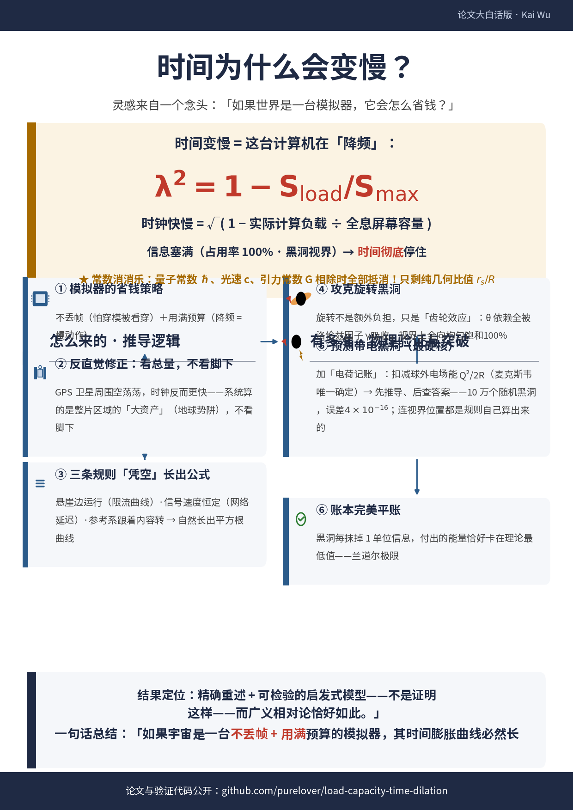
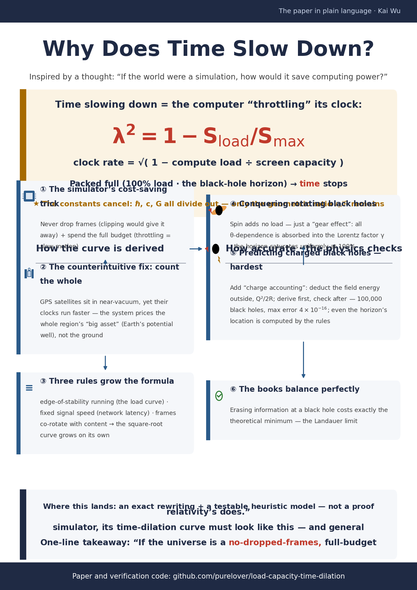

# Gravitational Time Dilation as an Information Load–Capacity Saturation Curve

**Idea by human; realization by AI (DeepSeek v4 pro).**

A plain-language showcase of the paper's core insight: general relativity's time-dilation curve
rewrites exactly as an information load–capacity saturation curve.

## Poster previews





## Contents

- `paper-chromium.pdf` — the paper in reading form (A4, 16 pages, Figure 1 embedded)
- `plain-language-slides.pptx` — 11-slide plain-language summary (Chinese)
- `plain-language-slides-en.pptx` — 11-slide plain-language summary (English)
- `poster-zh.png` — one-page plain-language poster (Chinese, A4)
- `poster-en.png` — one-page plain-language poster (English, A4)
- `make_poster.py` — regenerates both posters (matplotlib; run `python3 make_poster.py`)
- `verification.py` — reproduces every numerical claim of the paper (double precision)
- `fig1.png` — the universal collapse of all classical solutions onto λ = √(1−x)

## Run the verification

```bash
pip install numpy scipy
python3 verification.py
```

Expected output ends with "All checks passed."; all reported errors are at IEEE 754
double-precision roundoff level (ε_mach ≈ 2.2×10⁻¹⁶).

## License

MIT (code); CC-BY-4.0 (text and figures).
